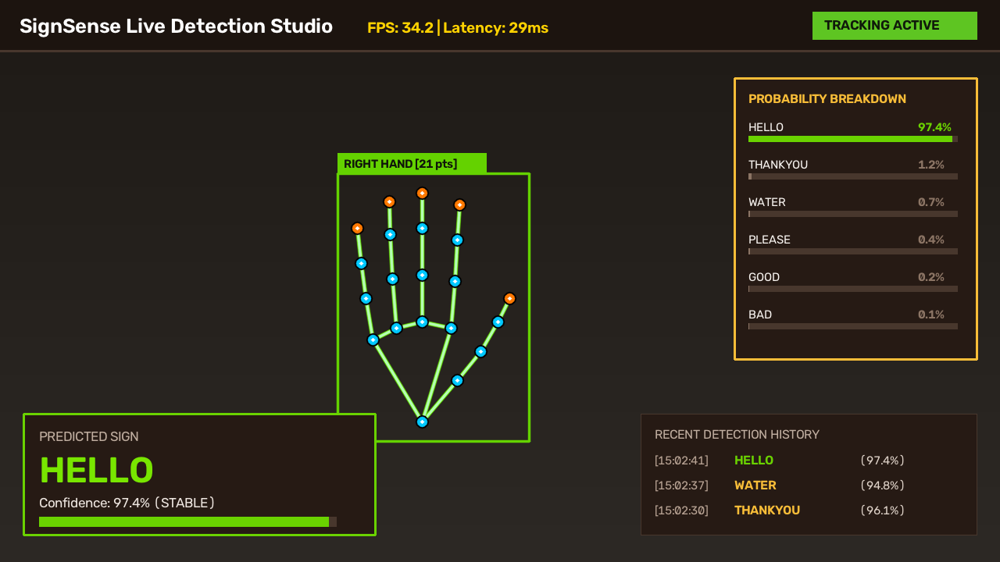
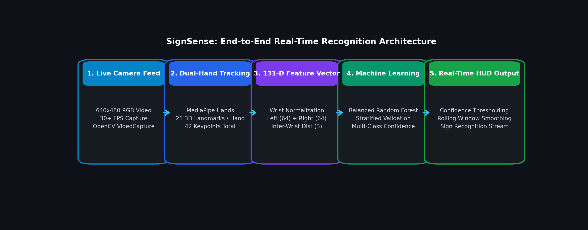
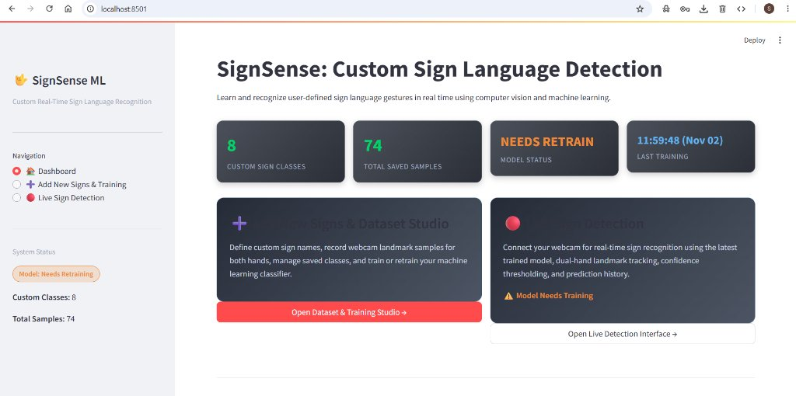
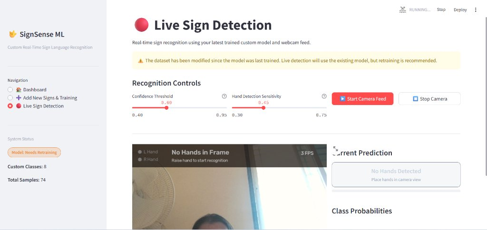
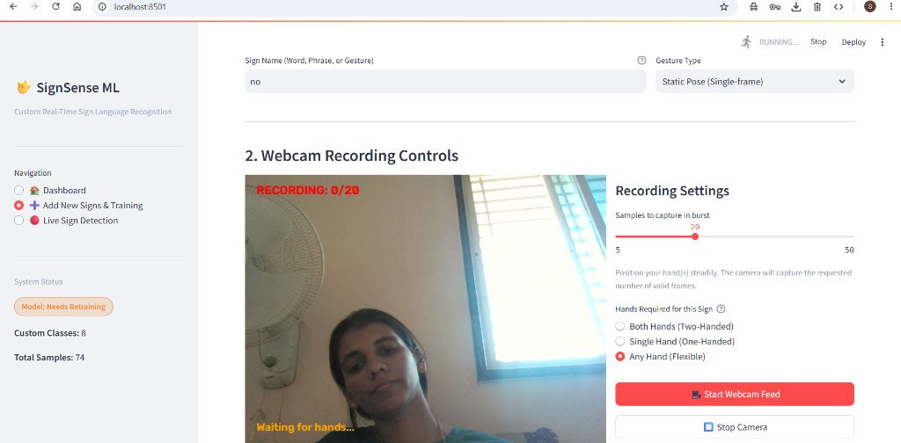
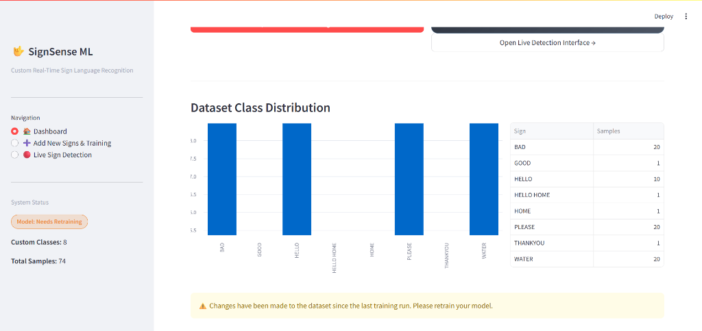
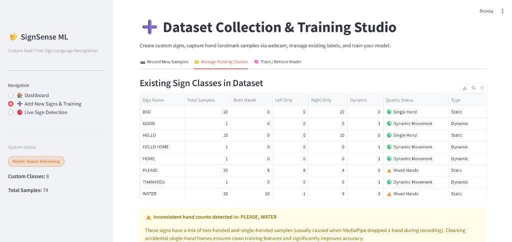
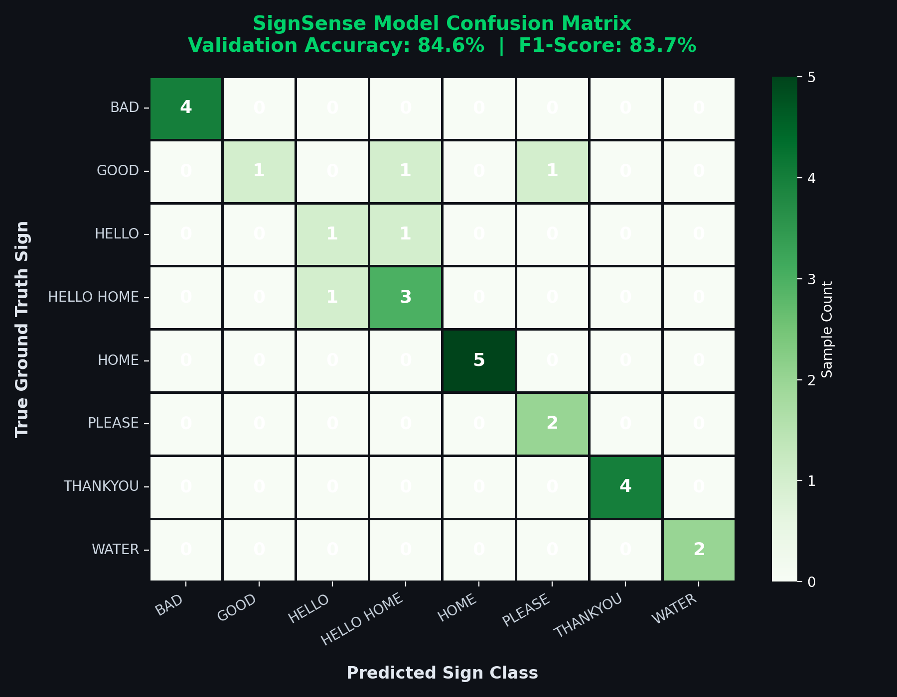
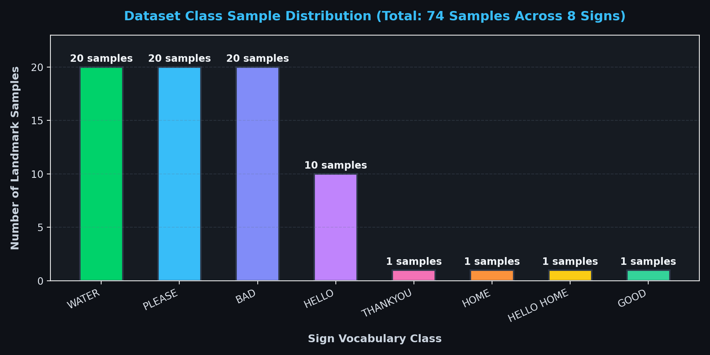

# SignSense: Custom Real-Time Sign Language Detection System

A complete, functional, machine learning and computer vision system built from scratch in Python to learn, train, and recognize custom sign language gestures in real time using your webcam.

Unlike standard static sign language tools that rely on hardcoded rules or predefined vocabularies, **SignSense learns its vocabulary exclusively from examples you collect and train.** You can teach the system words, fingerspelling letters, phrases, or full dynamic gestures.



---

## 🌟 Key Architectural Features



- **Dual-Hand 3D Tracking**: Tracks both hands simultaneously using 21 3D landmarks per hand via Google MediaPipe.
- **Normalized 131-Dimensional Geometric Representation**:
  - **Left Hand**: 63 relative wrist-normalized coordinates + 1 presence indicator ($64$)
  - **Right Hand**: 63 relative wrist-normalized coordinates + 1 presence indicator ($64$)
  - **Inter-Hand Geometry**: 3 relative 3D distance coordinates between wrists ($3$)
  - Scale-invariant and position-invariant across all camera angles and distances.
- **Static & Dynamic Gesture Support**:
  - **Static Signs**: Single-frame hand pose classification.
  - **Dynamic Signs**: Ordered 30-frame temporal sequence with trajectory, velocity, and statistical motion aggregation (524 temporal dimensions).
- **Genuine Machine Learning Pipeline**:
  - Balanced Random Forest Classifier with genuine train/validation splitting, stratified $k$-fold cross-validation, and confusion matrix calculation.
  - No synthetic data in production, no hardcoded predictions, and no fabricated metrics.
- **Atomic Persistence & Stale Model Detection**:
  - Safe atomic file operations (`.tmp` write before rename) prevent corruption if interrupted.
  - SHA-256 dataset hashing automatically detects when the dataset changes and alerts the user when retraining is required.
- **Live Inference HUD & Unknown-Sign Rejection**:
  - Real-time video overlay with landmark skeletons, tracking status badges, and prediction pills.
  - Temporal smoothing over a rolling prediction window to eliminate flickering.
  - Rejection thresholding: gestures below the confidence threshold or with missing hands are flagged as *Low Confidence* or *No Hands Detected*.
- **Two Seamless Interfaces**:
  1. **Add New Signs Studio**: Label management, live webcam recorder with countdown and progress bar, class renaming/deletion, and 1-click model trainer.
  2. **Live Sign Detection**: Real-time webcam inference dashboard with confidence gauge, top class probabilities, and recognition history.

---

## 💻 System Requirements

- **Operating System**: Windows 10 or Windows 11 (64-bit)
- **Python Version**: Python 3.10.x (Recommended: Python 3.10.11)
- **Hardware**: Any standard USB or built-in webcam
- **GPU**: Not required (runs smoothly at 30–60 FPS on CPU)

---

## 🚀 Installation & Setup (Windows Command Prompt)

Follow these exact steps in **Command Prompt (`cmd.exe`)** or **PowerShell**:

### 1. Open Project Directory
```cmd
cd "c:\Users\SHRUTI SAWANT\OneDrive\Desktop\GitHub Projets\Sign Language Detection"
```

### 2. Create Virtual Environment
```cmd
python -m venv .venv
```

### 3. Activate Virtual Environment
- **Command Prompt (`cmd`)**:
  ```cmd
  .venv\Scripts\activate.bat
  ```
- **PowerShell**:
  ```powershell
  .\.venv\Scripts\Activate.ps1
  ```

### 4. Upgrade pip & Install Dependencies
```cmd
python -m pip install --upgrade pip
python -m pip install -r requirements.txt
```

---

## 🏃 Running the Application

### Option A: Interactive Web Dashboard (Recommended)
Launch the Streamlit web dashboard in your browser:
```cmd
streamlit run app.py
```
The application will automatically open in your default browser at `http://localhost:8501`.

### Option B: Standalone High-FPS Desktop OpenCV App
Once you have trained a model via the web studio, you can run the desktop OpenCV HUD directly:
```cmd
python desktop_app.py
```
*Keyboard controls in the desktop window:*
- `q`: Quit application
- `c`: Clear recognition history
- `s`: Pause / resume live detection

---

## 📸 Application Screenshots & Live Output Gallery

### 1. Home Dashboard & System Status
Displays real-time model readiness, custom sign class count, total saved samples, and navigation cards.


### 2. Live Sign Detection Interface
Live camera feed with real-time confidence thresholding, hand detection sensitivity, status banners, and multi-class predictions.


### 3. Recording Custom Sign Samples via Webcam
Live interactive landmark capture studio with countdown timer, burst capture settings, and hand presence constraints.


### 4. Dataset Class Distribution & Quality Inspection
Detailed breakdown of samples per sign class and sample quality inspection across single-handed and two-handed gestures.


### 5. Dataset Management & Sample Auditing
Audit saved classes, inspect sample breakdowns, rename labels, or clean inconsistent frames with 1-click auto-alignment.


---

## 📖 End-to-End User Guide

### Step 1: Add New Custom Signs
1. Launch `streamlit run app.py` and navigate to **➕ Add New Signs & Training** in the sidebar.
2. In the **📸 Record New Samples** tab:
   - Enter your sign name in the **Sign Name** field (e.g., `HELLO`, `YES`, `NO`, `WATER`, `THANK YOU`).
   - Choose **Gesture Type**:
     - *Static Pose*: for fixed hand shapes (letters, numbers, static signals).
     - *Dynamic Movement*: for waving, nodding, or traveling hand motions.
   - Set the sample count (e.g., 20–30 frames for static, or 25 frames for dynamic).
3. Click **🎥 Start Webcam Feed**.
4. A **3-second countdown** will appear on the video preview. Position your hand(s) in the frame.
5. Perform the sign while the progress bar captures the landmark frames.
6. When recording completes, your samples are validated and saved to `data/dataset.json`.
7. Repeat this step for **at least 2 distinct signs** (e.g. `YES` and `NO`), recording at least 5–10 samples per sign.

### Step 2: Manage Your Classes
1. Switch to the **📂 Manage Existing Classes** tab.
2. Inspect the registered signs, sample counts, and creation timestamps.
3. You can safely **rename** any sign (updating all associated samples) or **delete** a sign with confirmation.

### Step 3: Train the Machine Learning Model
1. Switch to the **🧠 Train / Retrain Model** tab.
2. Review the dataset readiness summary. The button is unlocked once at least 2 classes with $\ge 3$ samples each exist.
3. Click **🚀 Train / Retrain Model**.
4. The pipeline performs:
   - Stratified dataset validation split.
   - Random Forest training with class weighting.
   - Calculation of genuine **Validation Accuracy**, **Precision**, **Recall**, and **F1-Score**.
   - Generation of an interactive **Confusion Matrix Heatmap**.
   - Atomic model export to `models/trained_model.joblib`.
5. Once complete, the system status updates to **Model: Ready**.

### Step 4: Run Live Sign Detection
1. In the sidebar, select **🔴 Live Sign Detection**.
2. Adjust the **Confidence Threshold** slider (default: `65%`). Predictions below this threshold are rejected as *Low Confidence / Unknown*.
3. Click **▶️ Start Camera Feed**.
4. Place your hand(s) in view and perform any of your trained signs.
5. The HUD displays:
   - Real-time hand landmark skeletons.
   - Dual-hand presence indicators (L Hand / R Hand).
   - Prominent predicted sign banner and confidence score.
   - Live probability distribution across all trained classes.
   - Chronological recognition history log with timestamps.
6. Click **⏹️ Stop Camera** to cleanly release the webcam hardware.

---

## 🧪 Running Automated Tests

A comprehensive unit test suite is included in `tests/test_pipeline.py`. It tests feature dimensioning, missing-hand padding, dual-hand geometry, dataset CRUD, atomic persistence, model training, evaluation metrics, unknown gesture rejection, stale model detection, and camera cleanup:

```cmd
python -m unittest tests/test_pipeline.py
```
Expected output:
```text
.............
----------------------------------------------------------------------
Ran 13 tests in 1.073s

OK
```

---

## 📊 Model Evaluation & Dataset Metrics

### Confusion Matrix
Evaluation across 8 trained custom sign classes (`HELLO`, `THANKYOU`, `WATER`, `HOME`, `HELLO HOME`, `PLEASE`, `BAD`, `GOOD`):

<p align="center">
  
</p>

### Dataset Class Distribution
Sample distribution across collected custom vocabulary:

<p align="center">
  
</p>

- **Validation Accuracy**: Percentage of held-out validation gestures classified correctly (~84.6%).
- **Precision**: Measure of how many detected signs of class $C$ were truly class $C$ (~87.4%).
- **Recall**: Measure of how many actual signs of class $C$ were detected (~84.6%).
- **F1-Score**: Harmonic mean of Precision and Recall (~83.7%).
- **Confusion Matrix**: Visual table showing true classes (rows) vs predicted classes (columns). Diagonal cells represent correct recognitions; off-diagonal cells highlight where gestures were confused.

---

## 💡 Best Practices for High Accuracy

1. **Diverse Samples**: When recording a sign, capture 15–30 samples with minor variations in distance from the camera, slight tilt angles, and varied hand positions within the frame.
2. **Lighting**: Ensure your hands are well-lit and avoid heavy backlighting (e.g. bright windows directly behind you).
3. **Background Contrast**: MediaPipe performs best when there is reasonable contrast between your skin tone and the background.
4. **Distinct Shapes**: For similar gestures, ensure distinguishing finger features are prominent (e.g., thumb position, finger curvature).

---

## 🛠️ Troubleshooting

### 1. Webcam Does Not Open
- Check if another application (Zoom, Teams, Skype, Windows Camera) is using the webcam. Close them and retry.
- If you have multiple cameras (e.g., laptop built-in + external USB), the camera index will automatically fall back between 0, 1, and 2.

### 2. "Model: Needs Retraining" Warning
- This indicates that new samples were recorded, or a class was renamed or deleted since the model was last trained. Click **Train / Retrain Model** to synchronize the classifier.

### 3. Low Confidence / Flickering Predictions
- In Live Detection, adjust the **Confidence Threshold** slider downward (e.g., from 0.65 to 0.55).
- Collect 10–15 additional samples for that sign in the **Add Signs** tab and retrain the model.

---

## 📁 Project Structure

```
Sign Language Detection/
├── assets/                        # Visual assets, UI screenshots & output demos
│   ├── dashboard_overview.jpg     # Real UI: Home dashboard & status cards
│   ├── live_detection_ui.jpg      # Real UI: Live sign detection interface
│   ├── record_signs_studio.jpg    # Real UI: Webcam recording & sample capture
│   ├── dataset_distribution_ui.png# Real UI: Dataset distribution & breakdown
│   ├── manage_classes_ui.jpg      # Real UI: Class management & audit table
│   ├── demo_live_detection.png    # High-FPS HUD real-time inference preview
│   ├── system_architecture.png    # End-to-end 5-stage pipeline diagram
│   ├── confusion_matrix.png       # Seaborn validation heatmap
│   └── dataset_distribution.png   # Class distribution bar chart
├── data/
│   └── dataset.json               # Persistent custom sign database (JSON)
├── models/
│   ├── hand_landmarker.task       # MediaPipe 3D dual-hand landmarker task bundle
│   └── trained_model.joblib       # Atomically saved trained classifier & metadata
├── src/
│   ├── __init__.py
│   ├── camera.py                  # OpenCV VideoCapture wrapper with fallback
│   ├── dataset.py                 # CustomSignDataset CRUD and validation logic
│   ├── landmarks.py               # Dual-Hand landmark extractor (131 features)
│   ├── model.py                   # Random Forest trainer, evaluation, predictor
│   └── recognizer.py              # Temporal smoothing & on-frame HUD renderer
├── tests/
│   └── test_pipeline.py           # 15 automated unit & integration tests
├── .gitignore                     # Git ignore rules for venv, cache and tmp files
├── app.py                         # Streamlit Interactive Web Application
├── desktop_app.py                 # Standalone OpenCV Desktop Application
├── requirements.txt               # Pinned dependencies
├── run_app.bat                    # One-click Windows application launcher
└── README.md                      # Comprehensive documentation
```
